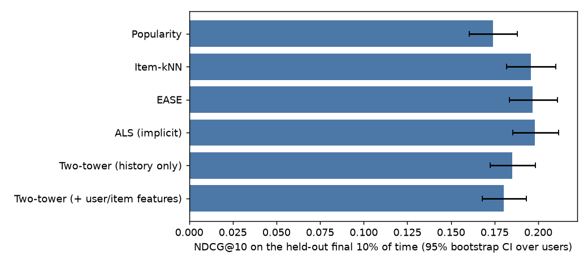

# recsys

A recommender benchmark on MovieLens-1M that is careful about the evaluation, plus a small
FastAPI service around a two-tower retrieval model.

The question it answers: **how much does a neural two-tower model actually add over strong
classical baselines when the protocol is honest?** On this dataset: not much, and in these
experiments nothing. The write-up below shows the numbers, the uncertainty, and where the
neural model loses.

Dataset: [MovieLens-1M](https://grouplens.org/datasets/movielens/1m/) (GroupLens, research use,
not redistributed here; `recsys fetch` downloads it and verifies the published checksum).

## Protocol

- **Global time split, not leave-one-out.** Positives (rating >= 4) are ordered by timestamp; the
  first 80% train, the next 10% validate, the final 10% test. Leave-one-out trains on other users'
  *future* behaviour, which leaks.
- **Full ranking.** Every model ranks the whole catalogue minus what the user already has. Sampled
  metrics (positive vs 100 random negatives) can reorder models and are not used.
- **Tuned on validation only, tested once.** Each model is tuned on the validation window, refit on
  train + validation with its chosen settings, and scored once on the test window.
- **The comparison partner is chosen without looking at test:** the best non-neural model on
  validation NDCG@10.
- **Cold items are dropped from the targets and counted**; users need at least 5 earlier positives.

<!-- setup:start -->
Positives (rating >= 4): 575,281. Train 460,224 | validation 57,503 | test 57,427 interactions (future positives on items never seen earlier were dropped: 23 validation, 104 test). Evaluated on **1,114 test users** (those with at least 5 earlier positives and at least one future one) and **480 validation users**.
<!-- setup:end -->

## Results

NDCG@10 on the held-out final 10% of time.

<!-- main-table:start -->
| model | NDCG@10 (95% CI) | Recall@10 | Hit@10 | NDCG@20 | item coverage@10 | mean popularity percentile of recs@10 |
|---|---|---|---|---|---|---|
| Random | 0.0118 (0.0091-0.0149) | 0.0029 | 0.095 | 0.0125 | 94.3% | 0.49 |
| Popularity | 0.1740 (0.1604-0.1879) | 0.0452 | 0.556 | 0.1682 | 2.4% | 1.00 |
| Item-kNN | 0.1958 (0.1819-0.2099) | 0.0536 | 0.593 | 0.1852 | 4.5% | 0.99 |
| EASE | 0.1969 (0.1834-0.2109) | 0.0579 | 0.612 | 0.1898 | 4.0% | 1.00 |
| ALS (implicit) | 0.1981 (0.1853-0.2116) | 0.0621 | 0.630 | 0.1939 | 7.1% | 0.99 |
| Two-tower (history only) | 0.1851 (0.1725-0.1985) | 0.0571 | 0.599 | 0.1818 | 13.6% | 0.97 |
| Two-tower (+ user/item features) | 0.1803 (0.1679-0.1933) | 0.0583 | 0.593 | 0.1772 | 16.3% | 0.97 |
<!-- main-table:end -->



### Is the neural model better?

<!-- significance:start -->
Paired bootstrap over users, difference in NDCG@10 versus **ALS (implicit)** (the best non-neural model on validation). Holm-adjusted across the 5 comparisons.

| model | difference | 95% CI | adjusted p |
|---|---|---|---|
| Popularity | -0.0241 | [-0.0328, -0.0158] | 0.003 |
| Item-kNN | -0.0023 | [-0.0091, +0.0044] | 1.000 |
| EASE | -0.0012 | [-0.0069, +0.0042] | 1.000 |
| Two-tower (history only) | -0.0130 | [-0.0197, -0.0062] | 0.003 |
| Two-tower (+ user/item features) | -0.0178 | [-0.0255, -0.0099] | 0.003 |
<!-- significance:end -->

### By how much history the user has

NDCG@10, test users bucketed by the number of positives known before the test window:

<!-- buckets:start -->
| model | history 5-20 (n=110) | history 21-60 (n=265) | history 61-150 (n=378) | history 151+ (n=361) |
|---|---|---|---|---|
| Random | 0.0107 | 0.0097 | 0.0144 | 0.0110 |
| Popularity | 0.2390 | 0.1856 | 0.1792 | 0.1403 |
| Item-kNN | 0.2779 | 0.2142 | 0.1901 | 0.1633 |
| EASE | 0.2863 | 0.2135 | 0.1925 | 0.1619 |
| ALS (implicit) | 0.2793 | 0.2201 | 0.1862 | 0.1696 |
| Two-tower (history only) | 0.2613 | 0.1990 | 0.1745 | 0.1627 |
| Two-tower (+ user/item features) | 0.2750 | 0.1981 | 0.1673 | 0.1520 |
<!-- buckets:end -->

### Tuning

All models got a comparable, small search; the budget per model is below. Tuning curves are in
`results/tuning.json`.

<!-- tuning:start -->
| model | configurations tried | chosen | validation NDCG@10 |
|---|---|---|---|
| Item-kNN | 10 | k=200, shrink=10.0 | 0.1230 |
| EASE | 9 | reg=30000.0 | 0.1243 |
| ALS (implicit) | 12 | factors=64, reg=200.0, alpha=5.0, iters=10 | 0.1301 |
| Two-tower (history only) | 4 | dim=64, temperature=0.07, lr=0.002, weight_decay=1e-06, epochs=1 | 0.1141 |
| Two-tower (+ user/item features) | 4 | dim=64, temperature=0.07, lr=0.002, weight_decay=1e-06, epochs=1 | 0.1170 |
<!-- tuning:end -->

## What the numbers say

- **Everything personalised beats popularity, and the classical models are indistinguishable from each other.**
  ALS, EASE and item-kNN land within 0.002 NDCG@10 of one another with confidence intervals that overlap almost completely;
  only popularity (-0.024) is separable from ALS. With ~1,100 test users this benchmark cannot rank the three classical
  models, and the README does not pretend it can.
- **The two-tower model is significantly *worse* than the best classical model** on accuracy:
  -0.013 (history only) and -0.018 (with features) NDCG@10, adjusted p = 0.003 for both. This holds under a tuning
  budget of 4 configurations versus 9-12 for the classical models, which is a real asymmetry (see Limitations).
- **What the two-tower does buy is breadth.** Its top-10 lists cover 14-16% of the catalogue versus 2-7% for the
  classical models, and it recommends slightly less popular items (popularity percentile 0.97 vs 0.99-1.00). If
  catalogue coverage matters to the product, that trade can be worth a small accuracy loss; if only NDCG matters, it is not.
- **Item features help only the thin-history users, tentatively.** For users with 5-20 prior positives the feature
  model is ahead of the history-only one (0.275 vs 0.261) and is the reverse for heavy users. The bucket has 110 users
  and no confidence interval is computed here, so this is a hypothesis for a larger dataset, not a finding.
- **Every model is weakest on the heaviest users** (151+ positives): they have already consumed most of the popular
  catalogue, so what is left to recommend is harder.

## The two-tower model

```
user tower:  mean of the embeddings of the user's history items (+ gender, age, occupation) -> MLP -> L2-normalise
item tower:  item-id embedding + genres + release-year bucket                                -> MLP -> L2-normalise
score:       cosine similarity / temperature
loss:        in-batch sampled softmax with logQ correction (Yi et al., 2019), accidental hits masked
```

The user tower is built from the user's *history*, not a per-user ID embedding, so it scores people
who were never in training. When a training pair (u, i) is constructed, the history shown to the
user tower is a random subset of u's items **excluding i**; otherwise the tower could copy the
target. A test checks this.

The tuned model overfits after one epoch in every configuration tried (validation NDCG@10 falls
after epoch 1). A side experiment (`scripts/dropout_check.py`, validation only) checks whether
dropout helps:

| | epoch 1 | 2 | 3 | 4 | 5 | 6 |
|---|---|---|---|---|---|---|
| no dropout | 0.1146 | 0.1090 | 0.1055 | 0.1085 | 0.1087 | 0.1070 |
| dropout 0.3 | 0.1133 | 0.1146 | 0.1123 | 0.1113 | 0.1073 | 0.1087 |

Dropout flattens the decline but does not raise the peak, so the best validation score is the same
(0.1146 vs 0.1146). The overfitting here is not a regularisation-strength problem that dropout alone fixes;
the item-id embeddings memorise a small catalogue. The tuned config (epoch 1, no dropout) is what is reported.

## Serving

```bash
recsys fetch && recsys export          # trains the chosen two-tower on all data, writes artifacts/
recsys serve                           # http://127.0.0.1:8000/docs
curl -s localhost:8000/recommend -H 'content-type: application/json' \
     -d '{"history":[2571,1196,260,1210],"k":5}'
```

`POST /recommend` takes a list of liked movie ids (any user, no account needed), `GET /similar/{id}`
returns nearest items in the item tower's space. Scoring is an exact matrix product: with a
3.7k-item catalogue that is far below a millisecond, so there is deliberately no ANN index; one is
worth adding when the catalogue is in the hundreds of thousands. The model is built from the
official download at image build time (`docker build -t recsys .`), because the dataset cannot be
redistributed.

## Limitations

- MovieLens ratings were collected in a few intense bursts; a global time split leaves only about
  1,100 users with both history and future, so confidence intervals are wide and small differences
  between the classical models are not resolved.
- Ratings, not exposures: the data says what people rated, not what they were shown, so every
  offline metric here is biased by the historical recommender that produced the exposure.
- Positives are ratings >= 4; no use is made of the rating value beyond that threshold.
- One dataset, one split, one seed per model. The neural model in particular might respond to more
  tuning than it got (4 configurations); the claim is about this budget, not about two-tower models in general.
- The two-tower here is trained for retrieval only; there is no ranking stage, no negative-feedback
  signal, and no online evaluation.

## Run it

```bash
pip install --extra-index-url https://download.pytorch.org/whl/cpu -e ".[dev]"
pytest                    # protocol, leakage and API tests
recsys fetch
recsys tune               # about 50 minutes on 4 CPU cores
recsys evaluate           # refit on train+val, score once on test
recsys report             # fills the tables above from results/
```

## References

Hu, Koren & Volinsky (2008), implicit-feedback ALS; Steck (2019), EASE; Yi et al. (2019),
sampling-bias-corrected two-tower retrieval; Krichene & Rendle (2020), on sampled metrics;
Ji et al. (2023), data leakage in recommender evaluation. MIT licence (code); MovieLens data is
subject to GroupLens' own terms.
